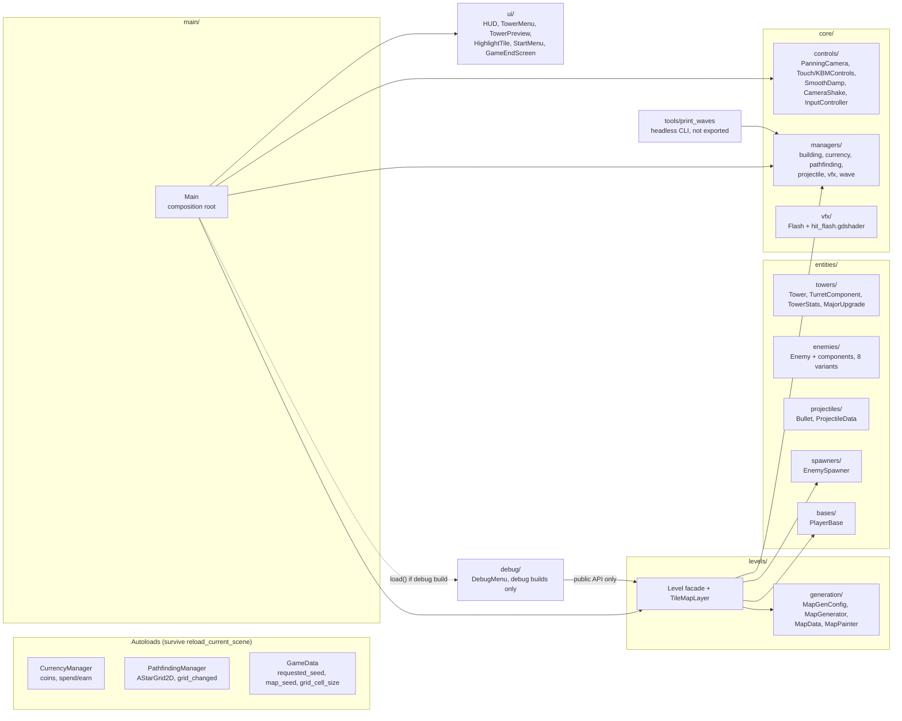
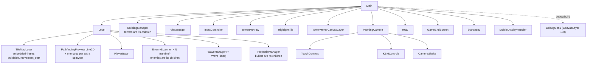
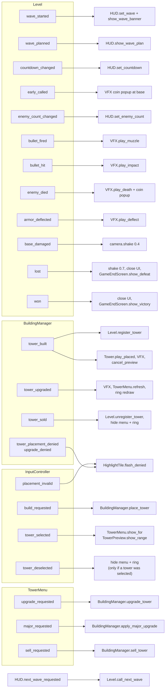

# 1. Overview: modules, scene tree, wiring

## Module map



## Scene tree at runtime

`main/main.tscn` is the main scene. Spawners are created at runtime by `Level._generate_map()`. The two spawners painted in `level.tscn` are freed.



The spawners are inserted *before* `WaveManager` in the tree (`level.gd:208`, `move_child(spawner, insert_at + i)`). Children are readied in tree order, so the spawners are ready before `WaveManager`, and `WaveManager` is ready before `Level`.

## Boot order

```mermaid
sequenceDiagram
  participant GD as GameData (autoload)
  participant L as Level._ready
  participant Gen as MapGenerator/Painter
  participant PF as PathfindingManager
  participant WM as WaveManager
  participant M as Main._ready
  participant SM as StartMenu

  GD->>GD: parse --seed= (requested_seed)
  Note over L: children are readied first, then Level
  L->>L: CurrencyManager.coins = 5
  L->>Gen: _generate_map(): pick seed, generate, paint
  L->>L: move PlayerBase, replace spawners
  L->>GD: map_seed = seed
  L->>PF: setup(tile_map_layer) (fresh AStarGrid2D)
  L->>WM: setup(spawners, map_seed)
  L->>L: connect relays, create path previews
  Note over M: Main is ready last (parent after children)
  M->>M: inject deps, connect all cross-scene signals
  M->>M: camera.fit_rect(level.get_map_rect())
  SM->>SM: paused = true (in its own _ready)
  SM-->>M: start_requested
  M->>L: input_enabled = true; level.start()
  L->>WM: start_next_wave() (wave 1, no countdown)
```

## The composition root: who listens to what

This is everything `Main._ready()` connects (`main/main.gd:20-71`).



## Autoloads and reloads

F1, restart and the end screen all call `get_tree().reload_current_scene()`. The scene tree is rebuilt, but the three autoloads keep their state, so:

| Autoload | Kept across reload | Reset by |
|---|---|---|
| `CurrencyManager` | `coins` | `Level._ready()` sets 5 |
| `PathfindingManager` | `astar_grid`, signal connections from freed nodes drop automatically | `setup()` builds a new `AStarGrid2D` |
| `GameData` | `requested_seed` (on purpose: restart replays the same map when a seed was given), `map_seed`, `grid_cell_size` | `map_seed` is rewritten every `Level._ready()` |

The debug menu's `debug_state.gd` uses `static var` for the same reason: its toggles survive reloads.

## Pause model

| Thing | `process_mode` | Why |
|---|---|---|
| `StartMenu`, `GameEndScreen` | pause the tree | menus |
| `PanningCamera` (+ Touch/KBM), `CameraShake` | ALWAYS, real-time delta | pan and zoom on menus and while paused |
| `TowerMenu`, `HighlightTile` | ALWAYS | building and selecting while *game*-paused is a feature |
| `VfxManager` | ALWAYS | effects finish behind the end screen |
| `InputController` | gated by `input_enabled`, not by pause | the menus block map taps, a game pause does not |
| `DebugMenu` | ALWAYS; its `ExtraWaveSpawner` is PAUSABLE | |
