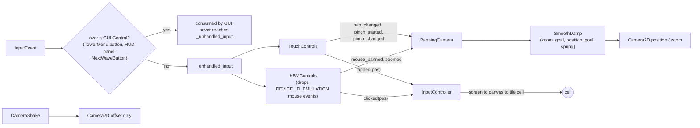
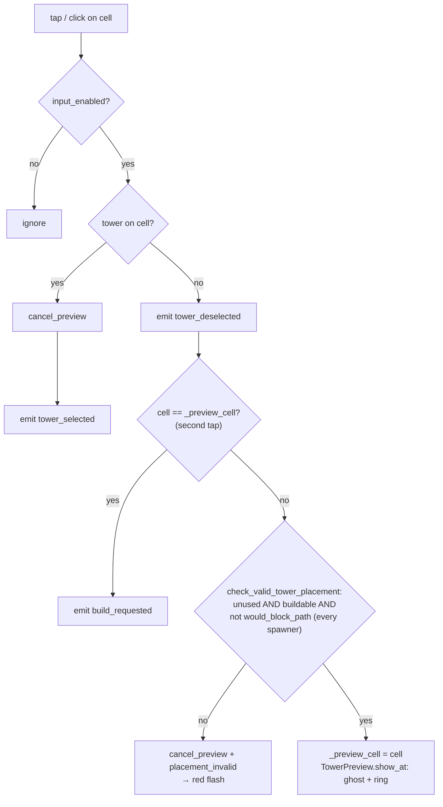
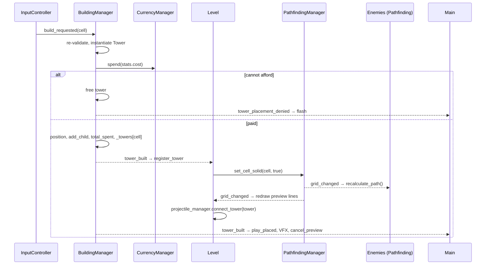
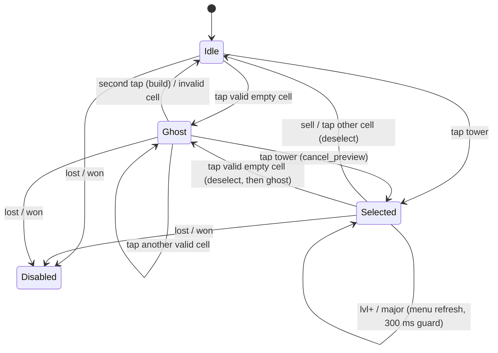

# 2. Input, building, selecting, upgrading

## Input pipeline

Both input paths are always connected. The split is by *meaning*: the camera consumes pan and zoom, and `InputController` consumes tap and click.



- **Tap** (`touch_controls.gd`): fires when the *last* finger lifts, as long as the touch stayed under 3 mm of travel (converted to viewport units per gesture), never had a second finger, and was not cancelled (focus loss clears all fingers).
- **Click** (`kbm_controls.gd:70`): press and release within 8 px with no panning.
- Mouse-wheel zoom is read with `Input.is_action_just_pressed` in `_process`, so it is **not** blocked by the GUI (see review findings).

## Decision tree on a cell (`InputController._handle_cell_input`, :40)



## Building (second tap)



## Selecting, upgrading, selling



**TowerMenu** (`ui/tower_menu/tower_menu.gd`) only emits requests. `BuildingManager` does all coin and tower changes:

| Button | Shown when | BuildingManager call | Cost |
|---|---|---|---|
| `lvl+` | level < 4 (no major due) | `upgrade_tower` → `Tower.upgrade()` | `TowerStats.cost × next level` |
| 3 majors (cannon icon, tinted) | level == 4 | `apply_major_upgrade` → `Tower.apply_major()` | `major_cost` 50 |
| `sell` | always | `sell_tower` → refund `total_spent`, `tower_sold` → `Level.unregister_tower` | refund |

**Effective tower stats** (`Tower._apply_upgrades`, rebuilt from a copy, base `TowerStats` never mutated):

```
damage, fire rate, range = base × (1 + 0.1 × level) × major multiplier
turn speed             = base turn_speed × major turn_speed_multiplier   (no level bonus)
```

Then `TurretComponent.configure(effective)` sets the reload timer and detection radius. A pending shot is never delayed (`min(time_left, new period)`).
