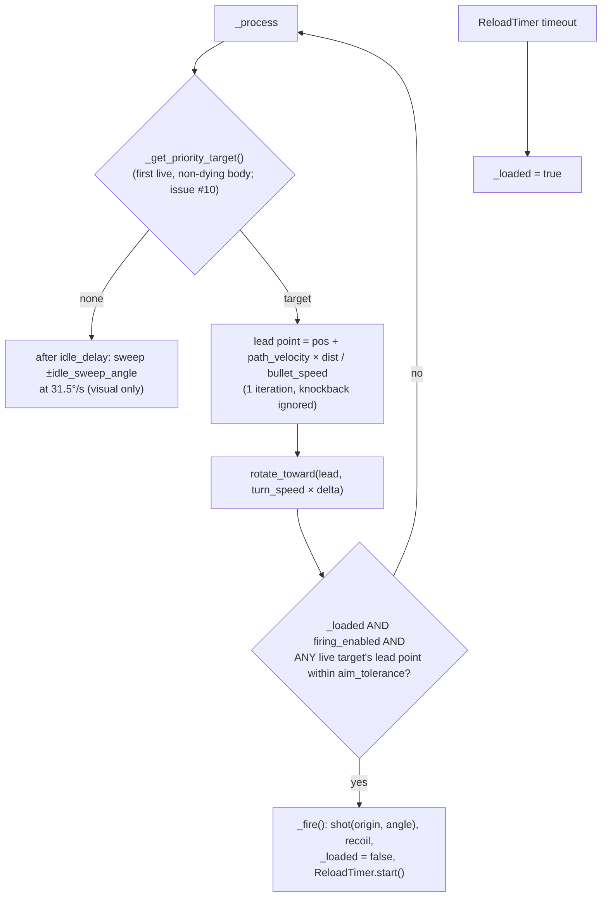
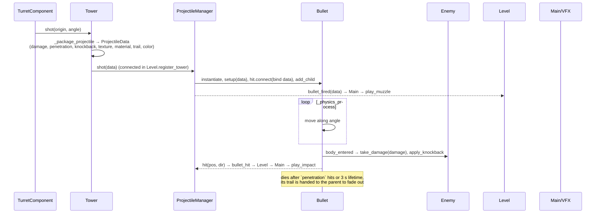
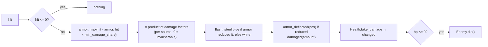

# 3. Combat and game feel

## Turret loop (`entities/towers/turret/turret_component.gd`, `_process`)

The reload timer starts only *after* a shot. The real fire rate is therefore slightly under `shots_per_second`, because it adds the time spent waiting to be aimed. This is on purpose.

## A shot, end to end

## Damage pipeline (`Enemy.take_damage`, enemy.gd:68)

`PlayerBase` uses the same damage-factor idea. God mode is the debug source `&"debug"` with factor 0.

## Game-feel layer

The rule is that effects are visual only and never change stats, timing or bullet origin.

| Trigger | Effect | Where |
|---|---|---|
| `bullet_fired` | muzzle burst | `VfxManager.play_muzzle` |
| `bullet_hit` | impact burst | `play_impact` |
| `enemy_died` | death burst + coin pop-up | `play_death`, `play_coin_popup` |
| `armor_deflected` | falling pixels (own cap 100) | `play_deflect` |
| `early_called` | coin pop-up at base | `play_coin_popup` |
| `tower_built` | burst + squash tween | `play_tower_built`, `Tower.play_placed` |
| `tower_upgraded` | burst + flash | `play_tower_upgraded` |
| base hit / loss | camera trauma 0.4 / 0.7 | `CameraShake` (offset only) |
| any hit | shader flash | `Flash.play` → `flash` uniform in `hit_flash` / `hue_swap` shaders |
| enemy state | smoke < 75 % hp, green `+` while healing, dash trail | `DamageSmoke`, `Regeneration`, `Dash` via `Enemy.attach_effect` |

All particles come from `VfxManager.make_particles()` (static factory, `GPUParticles2D`). Bursts are capped (`max_live_bursts`, `max_live_popups`, `max_live_deflects`) and freed on `finished` plus a safety timer.

**Hue swap** (`entities/towers/hue_swap.gdshader`): pixels with saturation above 0.5 get the major's `target_color` hue. This is why flashing with an overbright `modulate` is banned: it would feed the saturation test (and is lost on Web).
