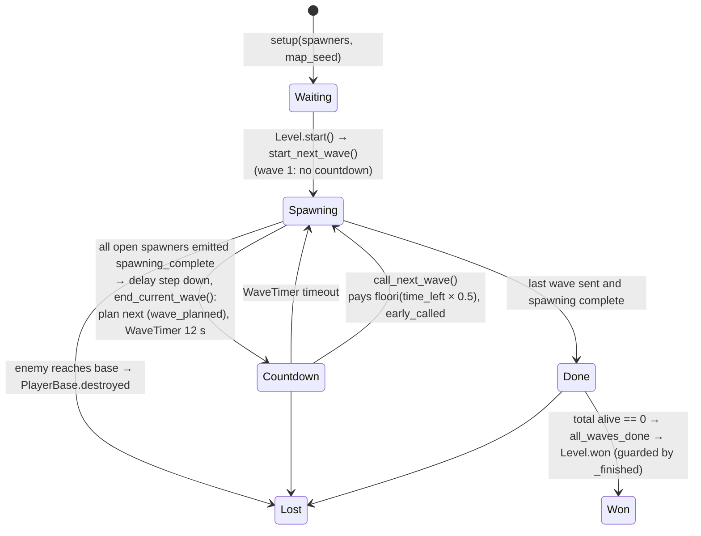
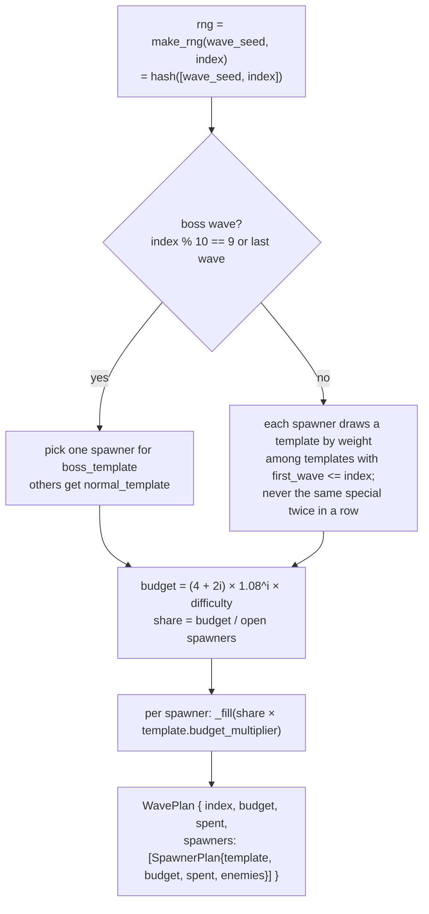
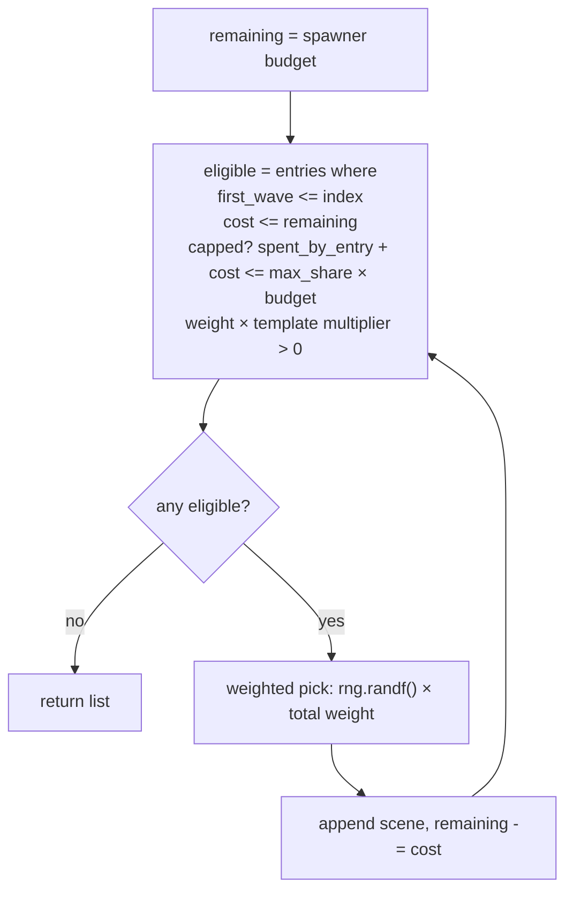
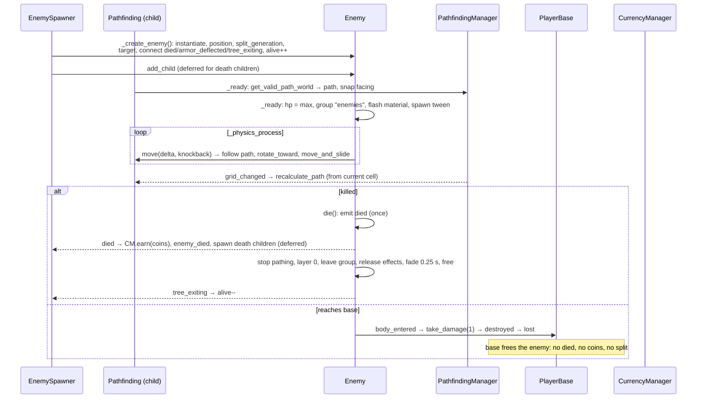

# 4. Waves and enemies

## Wave lifecycle (`core/managers/wave/wave_manager.gd`)

Waves overlap: the countdown starts when spawning *completes*, not when the wave is cleared.

### `start_next_wave()` in detail

1. Use the stored `_next_plan`. Re-plan with a `push_warning` if its index or open-spawner count no longer matches.
2. For each open spawner *k*: `set_active(true)`, record its template in `_last_templates[spawner]`, then `start_spawning(plan.enemies, delay × n × template.spawn_delay_multiplier, delay × (k + 1))`. The staggered first delay makes the spawners alternate.
3. `wave_index += 1`, then emit `wave_started`. Level redraws the previews (a newly opened spawner gets its line), and HUD shows the banner.

`spawn_delay` starts at 1.0 and drops by 0.1 after each wave whose spawning completed, down to a floor of 0.3 (reached after wave 7).

## Planning a wave (`WaveConfig.generate`, wave_config.gd:46)

The rng draw order is fixed: boss slot, then templates per spawner, then fills per spawner. A wave therefore depends on the seed, its index, the open-spawner count, and each spawner's previous template.

### The budget fill (`_fill`, wave_config.gd:98-148)

`basic` costs 1 and is uncapped, so a spawner ends within 1 point of its budget whenever basic is eligible.

Capped enemies only appear once `cost ≤ max_share × spawner budget`. With several spawners the budget is split, so they can appear later than their `first_wave`.

### Templates (`core/managers/wave/templates/`)

| id | special | weight | effect |
|---|---|---|---|
| normal | no | 3 | default |
| swarm | yes, from wave idx 2 | | basic & fast ×3, others ×0.3, delay ×0.5 |
| tank | yes, from idx 2 | | heavy & armored ×3, basic ×0.3, delay ×1.2 |
| rush | yes, from idx 2 | | fast & dasher ×3, delay ×0.7 |
| boss | (only via boss slot) | 0 | tank weights, budget ×1.5, delay ×1.2 (placeholder until phase 4) |

## Life of an enemy

Splitting (`EnemySpawner._spawn_death_children`): children are counted alive *immediately*, then added deferred at the parent's position plus 2-6 px. The alive count therefore never touches 0 between parent and children, and the win cannot fire early. Depth is capped at `MAX_SPLIT_DEPTH` 3, and a scene that spawns itself is refused.

## Enemy variants (placeholders)

| Variant | hp | speed | armor | coins | wave cost | weight | max_share | first banner wave | Extra |
|---|---|---|---|---|---|---|---|---|---|
| basic | 3 | 50 | 0 | 1 | 1 | 3 | 1 | 1 | |
| dasher | 2 | 60 | 0 | 1 | 2 | 2 | 0.4 | 4 | `Dash` ×3 for 0.5 s every 2.5 s |
| fast | 1 | 100 | 0 | 1 | 1 | 2 | 0.4 | 6 | |
| armored | 6 | 40 | 0.6 | 2 | 5 | 1 | 0.4 | 7 | `DamageSmoke` |
| regenerator | 8 | 45 | 0 | 3 | 4 | 1 | 0.4 | 9 | `Regeneration` 2 hp/s after 1.5 s; smoke |
| heavy | 10 | 30 | 0 | 3 | 4 | 1 | 0.4 | 11 | smoke |
| splitter | 12 | 35 | 0 | 3 | 6 | 1 | 0.3 | 12 | 3× `mini` on death; smoke |
| mini | 1 | 90 | 0 | 1 | never in waves | | | | |

Enemy components: `Health` (Resource, local to scene), `Pathfinding` (Node, reads `owner`), `EnemyStats`/`Drops` (Resources), and optional ability or effect nodes. Speed factors and damage factors are dictionaries keyed by source (`&"dash"`, `&"debug"`), and their values are multiplied.

## Pathfinding

`PathfindingManager` keeps one `AStarGrid2D` over the tile layer's used rect. It uses `DIAGONAL_MODE_ONLY_IF_NO_OBSTACLES`, and cells with `movement_cost == 255` are solid. There are no weights: roads are cosmetic, and enemies take the shortest path.

- `set_cell_solid()` emits `grid_changed`. Every enemy re-paths, and the preview lines are redrawn.
- `would_block_path(cell, start, end)` temporarily makes the cell solid and asks for a path. `Level.would_block_path` asks this for **every** spawner, open or not.
