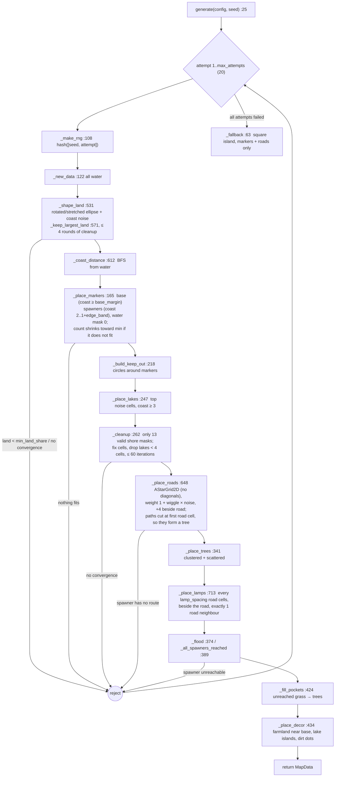
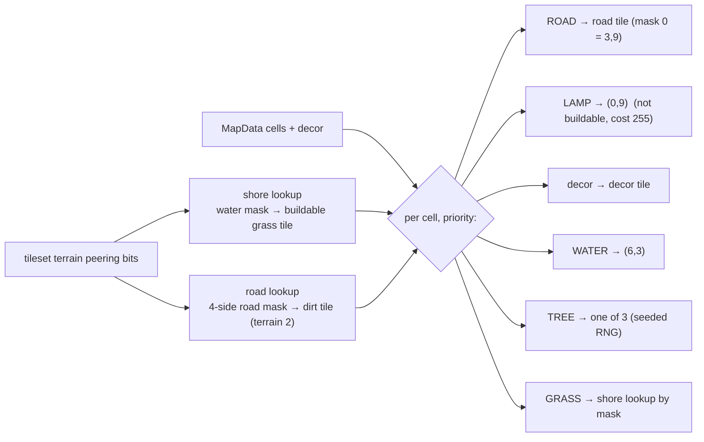

# 5. Map generation

`Level._generate_map()` runs these steps in order: `_pick_seed()` → `MapGenerator.generate(config, seed)` → `tile_map_layer.clear()` → `MapPainter.paint()` → move `PlayerBase` → replace the spawners. `MapGenerator` and `MapData` are pure data. They use no nodes, no autoloads and no global random.

## Generator pipeline (`levels/generation/map_generator.gd`)

### Why the shore cleanup exists

The tileset has no tile for grass with water on two *opposite* sides, and none for a diagonal water pinch. A grass cell may therefore only have one of 13 water masks (`MapData.is_valid_shore_mask`). `_cleanup` turns offending cells into water or grass until the map is stable.

## Painter (`levels/generation/map_painter.gd`)

## Data types

- `MapGenConfig` (Resource, `default_map.tres`): every tunable. The `.tres` only overrides `spawner_count_max` 10, lakes, trees and decor density.
- `MapData` (RefCounted): `cells: PackedByteArray` of `Cell {WATER, GRASS, TREE, ROAD, LAMP}`, plus `decor`, `base_cell`, `spawner_cells`, `spawner_first_waves`, `attempts`, `used_fallback`.

After the level is ready, `Main` calls `PanningCamera.fit_rect(Level.get_map_rect())`. It centres the camera, zooms the map to fit, and lowers `min_zoom` to that zoom.
