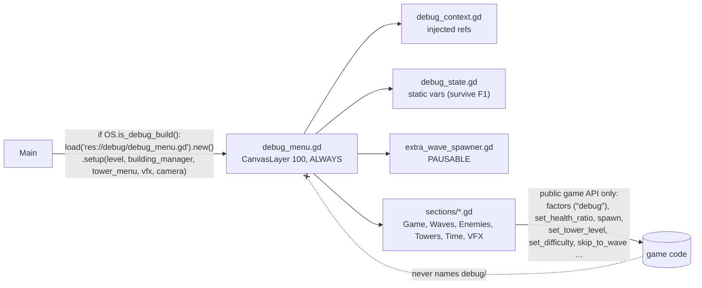
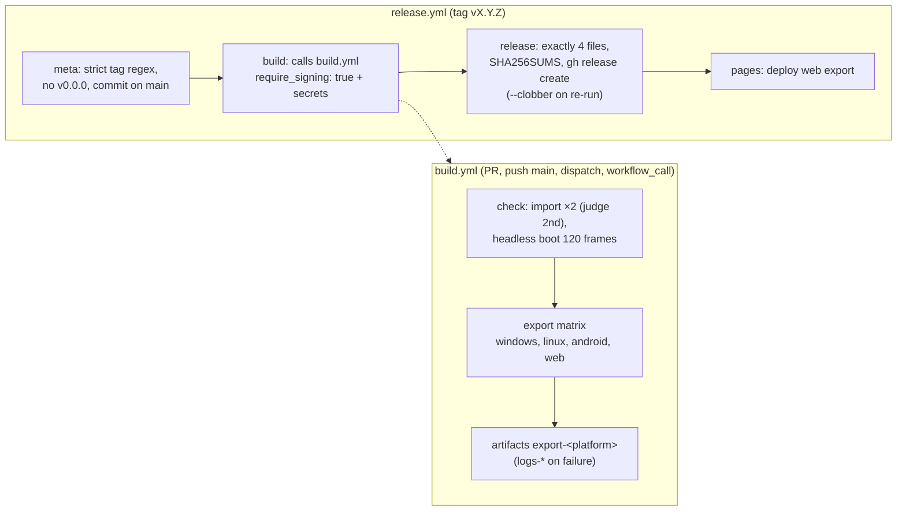

# 6. Debug menu and CI

## Debug menu: the one-way rule

- There is no `class_name` in `debug/`. Scripts use `preload` consts and `extends "res://debug/..."`. This lets a release export drop the folder: the CI appends `debug/*` to `exclude_filter` on tag builds.
- New tools go in a new `sections/<name>_section.gd`, which extends `debug_section.gd` and implements `build(ctx)`, `refresh()` (polled every 200 ms while the menu is open) and `apply_state()`.

## CI / release

| Build | Export mode | debug/ included | Android key |
|---|---|---|---|
| PR / main / manual | `--export-debug` | yes | throwaway debug key |
| tag release | `--export-release` | no (`debug/*` excluded via sed) | release keystore secrets |

Security conventions: top-level `permissions: contents: read`, and jobs raise only what they need. `${{ }}` values are never put inside `run:`; they are passed through `env:`.
