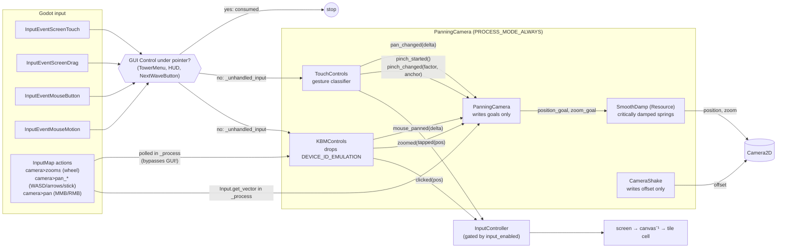
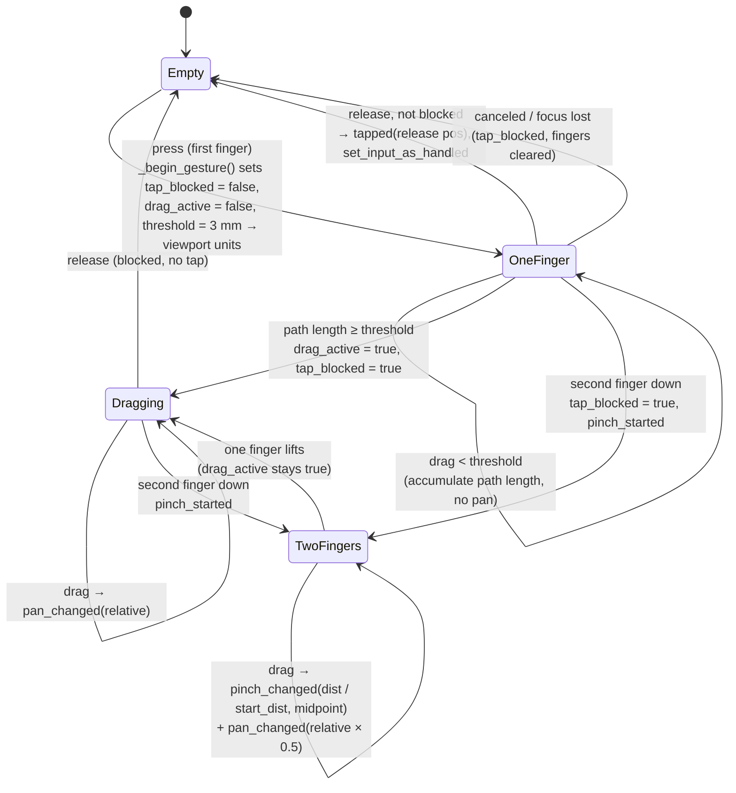
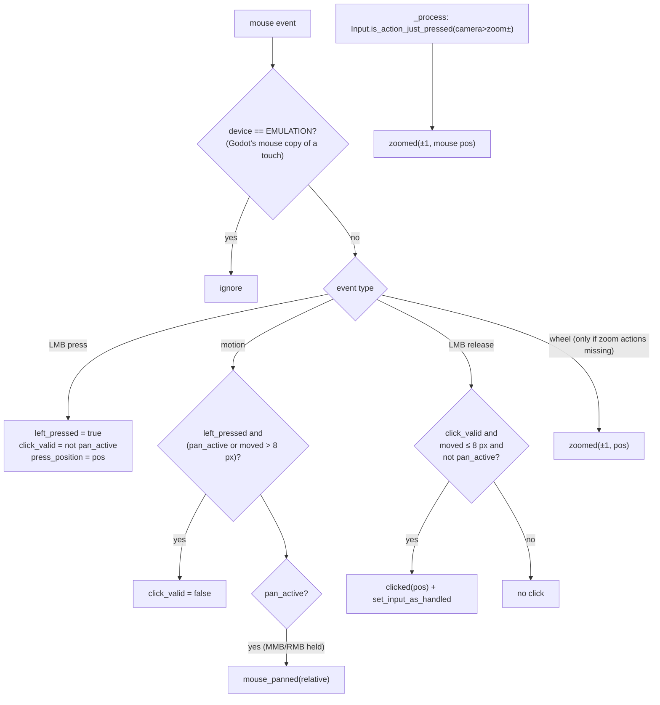
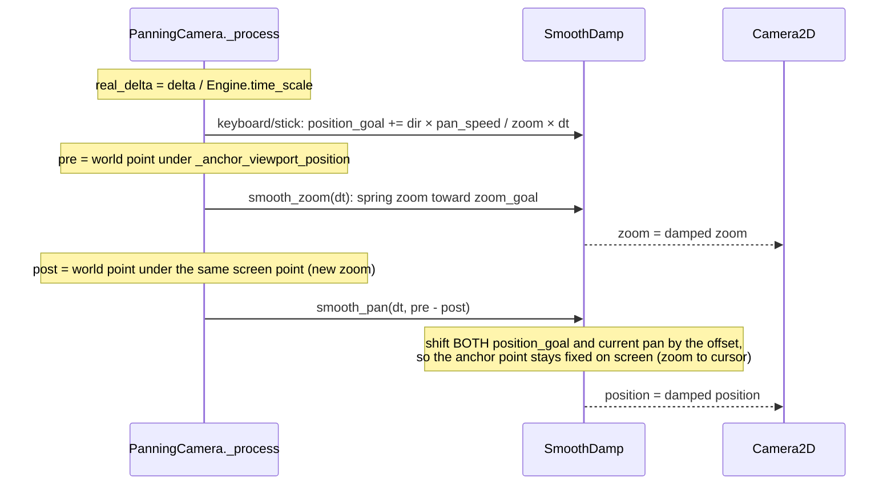

# 7. Controls deep dive (`core/controls/`)

Rendered PNGs of these diagrams are in `img/controls-*.png`.

## 7.1 Wiring: raw events → meaning → consumers

<!-- controls-1-wiring -->

Who owns which `Camera2D` property:

| Property | Written by | Never written by |
|---|---|---|
| `position`, `zoom` | `SmoothDamp` output, via `PanningCamera._apply_smooth_damp` (and `fit_rect` once) | input handlers, which only move *goals* |
| `offset` | `CameraShake` | everything else |

## 7.2 Touch gesture classifier (`TouchControls`)

<!-- controls-2-touch -->

Details worth knowing:
- The threshold is the *accumulated path length*, not the distance from the start, so a finger that wobbles out and back still counts as a drag.
- In a two-finger pan, each finger's drag event emits `relative × 0.5`. Summed over both fingers, that gives the movement of the midpoint.
- A pinch is re-armed whenever the finger count becomes exactly two. `PanningCamera` stores `_pinch_start_zoom = zoom.x` (the *current* zoom, not the goal), and the zoom goal becomes `start × factor`, clamped.
- A finger whose press was consumed by the GUI is unknown to `_touch_points`. Its drags are ignored and its release can never tap (`known == false`).

## 7.3 Mouse click vs pan (`KBMControls`)

<!-- controls-3-mouse -->

## 7.4 One camera frame (`PanningCamera._process`)

<!-- controls-4-frame -->

The spring (`_smooth_damp`) is the classic *Game Programming Gems 4* critically damped spring, the same algorithm as Unity's `SmoothDamp`. It uses `omega = 2 / (smooth_time / 2)` and a polynomial approximation of `exp(-x)`, and clamps per axis so it never overshoots the goal.

The zoom steps are symmetric: zooming in multiplies by `1 / 0.9` and zooming out by `0.9`, so one step in and one out returns exactly to the start.

## 7.5 Findings in the controls code

- **The mouse wheel zooms over the GUI** (seen in playtests, issue 004). Zoom is polled with `Input.is_action_just_pressed` in `_process`, which runs regardless of the GUI. Scrolling over the HUD or the tower menu zooms the map.
- **Fast scrolling loses steps** (issue 006). `just_pressed` is true once per frame, so several wheel ticks within one frame zoom by only one step. An `if`/`elif` also means zoom-in wins if both happen in the same frame.
- **There is no pan limit** (seen in playtests, issue 005). `fit_rect()` limits zoom out (`min_zoom`), but `position_goal` is never clamped, so the camera can drift off the island forever.
- **`_smooth_damp` has a no-op line.** `target = current - change` is a no-op, since `change = current - target`. In Unity this line exists to apply a `maxSpeed` clamp, which this version doesn't have.
- **`zoom_by()` is unused** (also listed in the review findings).
- *By design:* **a tap fires at the *release* position.** A click does the same. That's consistent, but it means a touch that drifted almost 3 mm acts on the cell under the finger at release.
- *By design:* **the drag dead zone is swallowed.** The first 3 mm of a one-finger drag are not panned, so the map starts moving a little behind the finger. This is probably intended, since it prevents jitter.
