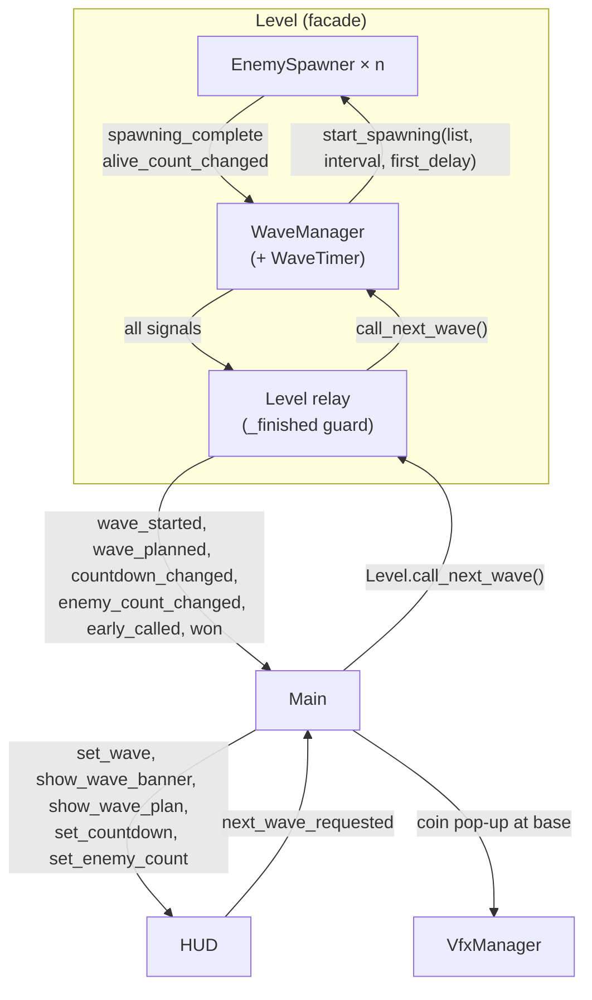
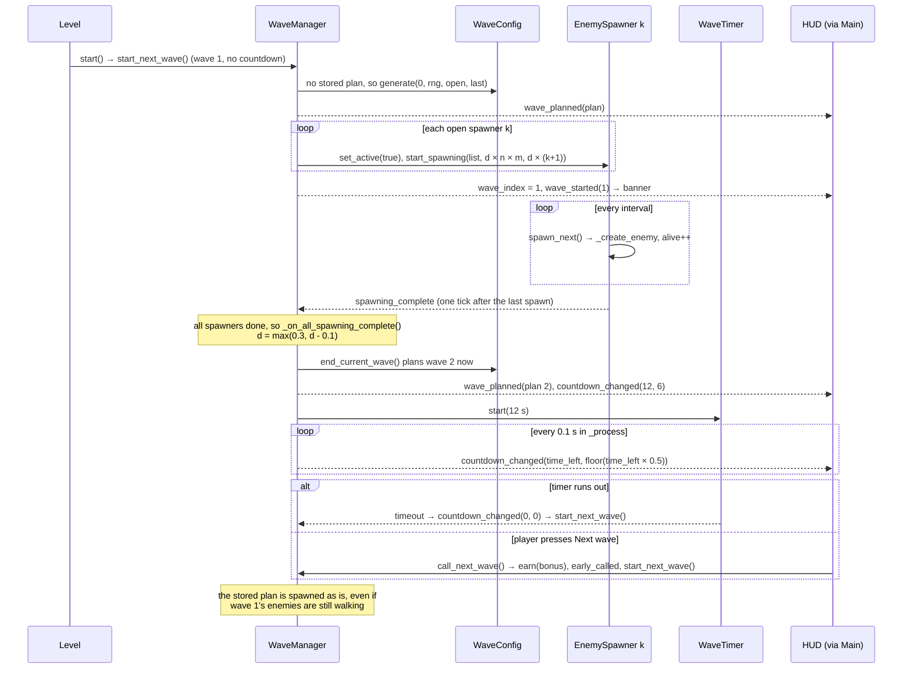
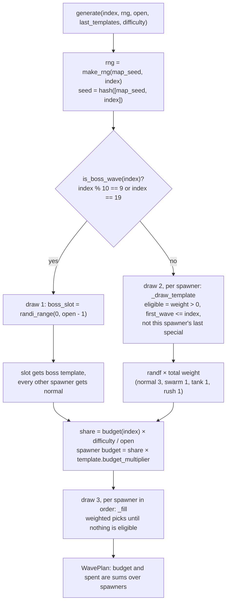
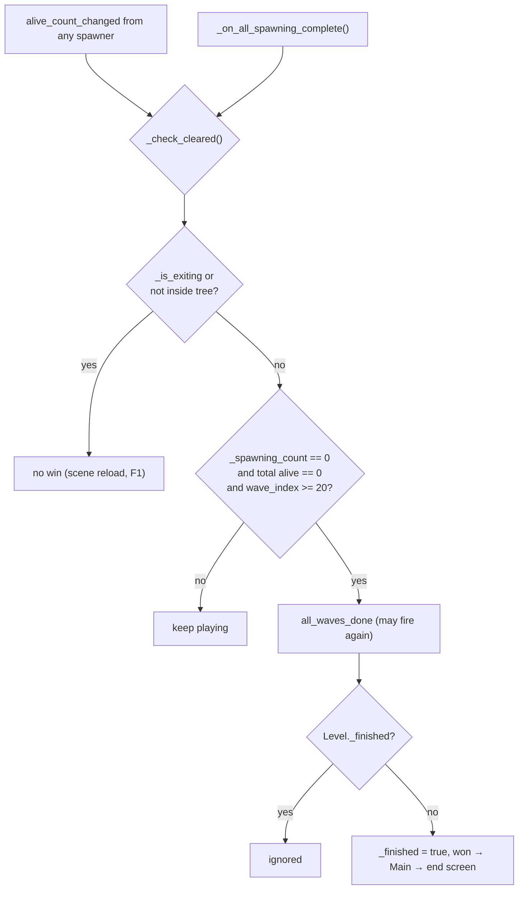

# 8. Wave system deep dive (`core/managers/wave/`)

Rendered PNGs of these diagrams are in `img/waves-*.png`. Chapter 4 has the short version. This one walks the code.

## 8.1 Who is who

| File | Kind | Role |
|---|---|---|
| `wave_manager.gd` | `Node` (child of `Level`) | Runtime: owns `wave_index`, the countdown (`WaveTimer`), spawn pacing, the stored next plan, and the win check |
| `wave_config.gd` | `Resource` (`default_waves.tres`) | Pure planner: `budget()`, `make_rng()`, `is_boss_wave()`, `generate()`. No nodes, no autoloads, no global random |
| `wave_template.gd` | `Resource` (`templates/*.tres`) | The flavour of one spawner's share: weight, budget and delay multipliers, enemy weight multipliers |
| `wave_enemy.gd` / `wave_enemy_weight.gd` | `Resource` | One buyable enemy (`cost`, `weight`, `max_share`, `first_wave`) / one template multiplier |
| `wave_plan.gd` / `spawner_plan.gd` | `RefCounted` | The output: one `SpawnerPlan` (template, budget, spent, `enemies` list) per open spawner |
| `entities/spawners/enemy_spawner.gd` | `Node2D` | Plays a list at the pace it is given and counts its own alive enemies |

The split to remember: **`WaveConfig` decides *what* spawns, `WaveManager` decides *when*, and `EnemySpawner` only does it.**

## 8.2 Wiring

<!-- waves-1-wiring -->

Main never touches `WaveManager`. Even the button press goes HUD → Main → `Level.call_next_wave()` → `WaveManager`. Only the debug menu reads it directly, through `Level.get_wave_manager()`.

## 8.3 One wave cycle

<!-- waves-2-cycle -->

Things worth knowing:
- **Waves overlap.** The countdown starts when *spawning* ends, not when the wave is cleared. A slow defence fights two waves at once.
- **The plan is made at countdown start**, not at wave start. That is what lets the HUD know a special wave is coming (the banner reads the stored plan when `wave_started` arrives). `start_next_wave()` re-plans only if the stored plan no longer matches the index or the open-spawner count (with a `push_warning`).
- **`spawning_complete` fires one interval late.** On the tick that spawns the last enemy, the queue is not empty yet, so the timer restarts. The *next* tick finds it empty and completes (issue 041).
- **The countdown pauses with the tree.** `WaveTimer` and `_process` both stop on pause, so a paused game neither loses countdown time nor bonus.

## 8.4 Pacing

`d` is the stepped delay: 1.0 on wave 1, minus 0.1 after each wave whose spawning completed, floor 0.3 from wave 8. With `n` open spawners, spawner *k* (0-based) gets:

- first enemy after `d × (k + 1)`
- then one every `d × n × template.spawn_delay_multiplier`

So with 2 spawners and `d = 1`: spawner 0 spawns at 1, 3, 5…, spawner 1 at 2, 4, 6…. The whole map spawns one enemy per `d` seconds, alternating. When the two spawners drew different templates (swarm ×0.5, tank ×1.2), their intervals differ and the alternation drifts. That is fine, since each spawner's share is its own flavour.

A spawner with an empty list is skipped but keeps its `k`, so its slot in the stagger stays empty.

## 8.5 Planning one wave (`WaveConfig.generate`)

<!-- waves-3-generate -->

Template odds from banner wave 3: normal 3 of 6, so a spawner is special half the time. Right after a special, that special is excluded: 2 of 5 = 40 % for another (different) special. Boss waves skip the draw entirely, so every non-boss spawner there is normal.

### Why the draw order matters

Everything comes from one rng per wave, consumed in a fixed order. Change anything upstream, and every later draw of *that wave* shifts:
- the open-spawner count (a map with 3 spawners plays a different wave 6 than a map with 2),
- each spawner's previous template (it changes the eligible list),
- `difficulty` (it changes budgets, so the fill loop draws a different number of times),
- adding, removing or reordering entries in `enemies` or `templates`.

Other waves are untouched, because each wave re-seeds from `[map_seed, index]`. That is the point of `make_rng`: wave 7 does not depend on how many draws wave 6 made.

### The fill loop (`_fill`)

Each pass rebuilds the eligible list: `first_wave <= index`, `cost <= remaining`, the `max_share` cap, and `weight × template multiplier > 0`. Then it rolls once, appends the scene, and subtracts the cost. It stops when nothing is eligible.

- `basic` costs 1 and is uncapped, so a spawner usually ends within 1 point of its budget.
- A capped enemy fits only once `cost <= max_share × spawner budget`. With 3 spawners the budget is split three ways, so a splitter (cost 6, cap 0.3) needs a spawner budget of 20 before it can appear at all, whatever its `first_wave` says.
- A template with `other_multiplier = 0.3` (swarm) does not ban others. It makes them rarer.
- Order in the list = spawn order. There is no sorting, so a heavy can lead the wave.

## 8.6 Numbers (placeholders, 1 open spawner, difficulty 1)

| Banner wave | Budget | `d` (s) | Notes |
|---|---|---|---|
| 1 | 4.0 | 1.0 | basic only |
| 2 | 6.5 | 0.9 | |
| 3 | 9.3 | 0.8 | specials can be drawn; spawner 2 opens (`spawner_first_waves` [0, 2, 5]) |
| 4 | 12.6 | 0.7 | dasher |
| 5 | 16.3 | 0.6 | |
| 6 | 20.6 | 0.5 | fast; spawner 3 opens |
| 7 | 25.4 | 0.4 | armored |
| 8 | 30.8 | 0.3 | floor reached |
| 9 | 37.0 | 0.3 | regenerator |
| 10 | 44.0 | 0.3 | **boss slot** (budget ×1.5 for that spawner) |
| 11 | 51.8 | 0.3 | heavy |
| 12 | 60.6 | 0.3 | splitter |
| 15 | 94.0 | 0.3 | |
| 20 | 181.3 | 0.3 | **boss slot**, last wave |

Budget = `(4 + 2i) × 1.08^i`, with `i` = banner − 1. The budget is a total for the wave, split between the open spawners, so more spawners means the same threat spread over more lanes (plus the boss bonus).

The early-call bonus is `floor(time_left × 0.5)`: 6 coins at the very start of the 12 s countdown, 5 a tenth of a second later. Wave 1 has no countdown, so a run has 19 countdowns: about 95 coins if the player always calls at once, 114 at most. There is no cap (issue 028).

When a capped enemy can first appear depends on the spawner count. A splitter (cost 6, cap 0.3) needs a spawner budget of 20:

| Open spawners | Splitter first possible |
|---|---|
| 1 to 3 | banner 12 (3 spawners: 60.6 / 3 = 20.2, just enough) |
| 4 | banner 14 (81.6 / 4 = 20.4) |
| 5 | banner 16 (107.9 / 5 = 21.6) |

A boss slot (×1.5) or difficulty above 1 can bring it earlier for that spawner, never before its `first_wave`.

## 8.7 How the game is won

<!-- waves-4-win -->

Each condition has a reason:
- `wave_index >= 20` alone is not enough: wave 20 is "sent" the moment it starts.
- `_spawning_count == 0` covers the gap between two spawns, when alive can briefly be 0.
- Total alive over **all** spawners, because waves overlap and spawners finish at different times.
- `_is_exiting` because a reload frees every enemy, each one decrements the count, and the last would look like a clear.
- Split children are counted inside the parent's `died` handler, before the parent leaves the tree, so the count never dips to 0 (see chapter 4).

Losing is not the wave system's business: the first enemy to touch `PlayerBase` (health 1) emits `destroyed`, and `Level` reports `lost`, also guarded by `_finished`.

## 8.8 Debug hooks

These are public `WaveManager` methods that only the debug menu calls (the one-way rule holds: the game never names `debug/`):
- `set_difficulty(x)`: budget multiplier, re-plans the stored plan.
- `skip_to_wave(i)`: moves `wave_index`, re-plans, and restarts the flow if the run had finished. A running wave is not touched.
- `set_countdown_paused(b)`: pauses only `WaveTimer`.
- `set_spawn_delay_multiplier(m)`: also retimes spawners still spawning (issue 008: it uses the next wave's open count).

## 8.9 Findings in the wave code

- `start_next_wave()` stops the timer before its "still spawning" return (issue 002, latent).
- `set_spawn_delay_multiplier()` uses the wrong open count (issue 008).
- Calling early has no cap (issue 028), and `waves_survived` counts waves started (issue 038).
- **New:** `spawning_complete` fires one interval after the last spawn (issue 041, low).
- Death-child offsets use the global `randf()`. Waves stay deterministic, but the minis' exact positions do not. By design (cosmetic randomness).
- Wave 1 starts with no build phase or countdown (issue 043).
- Pacing and the early-call model are up for a redesign (issue 044): the per-spawner interval grows with the spawner count, and the countdown resets after every wave.
- `tools/print_waves.tscn` is the way to see a seed's waves without playing. Godot is not installed in this environment, so the table above is computed from the formula, not printed.
