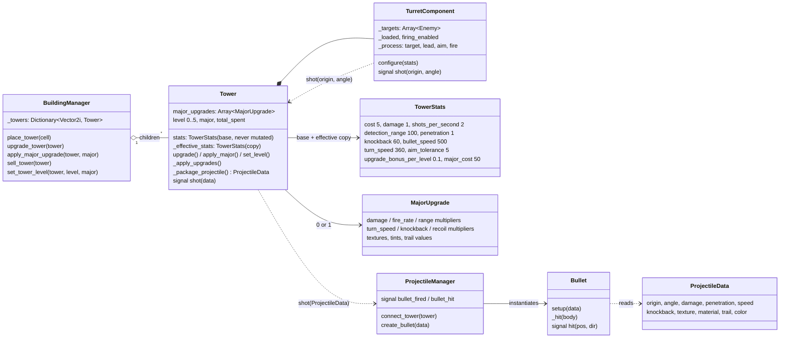
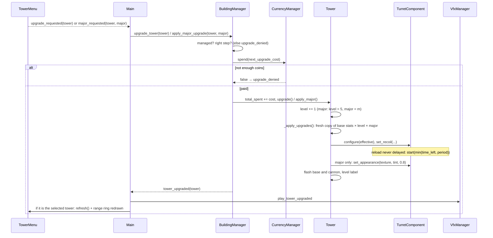
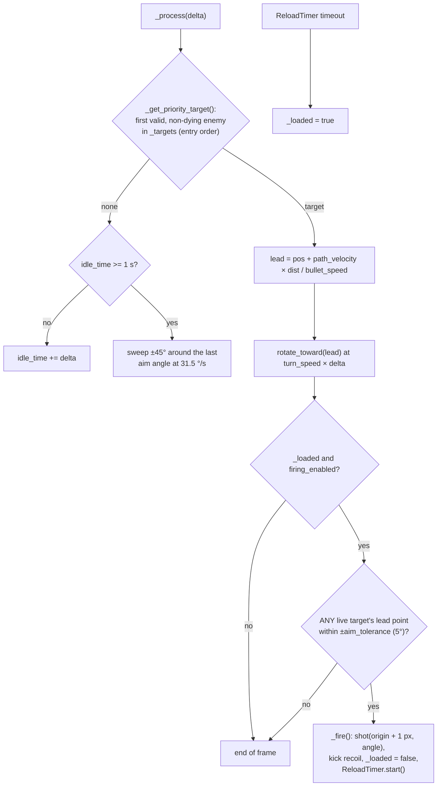

# 9. Combat and towers deep dive

Rendered PNGs of these diagrams are in `img/towers-*.png`. Chapter 3 has the short version (shot sequence, damage pipeline, game-feel table). This one walks the tower code.

## 9.1 Who is who

<!-- towers-1-structure -->

The layering:
- **`TurretComponent` knows nothing about damage.** It only decides *where* and *when* to shoot, and emits an origin and an angle.
- **`Tower` turns that into a `ProjectileData`**: damage, penetration, knockback and the major's look. It is the only place that combines base stats, level and major.
- **`ProjectileManager` owns the bullets**, and `Level` hooks each tower to it (`register_tower`). `BuildingManager` never touches bullets.
- **`BuildingManager` owns money.** `Tower.upgrade()` and `apply_major()` never touch coins. `total_spent` lives on the tower but only `BuildingManager` writes it.

## 9.2 Stats: base, level, major

`Tower._apply_upgrades()` rebuilds `_effective_stats` from scratch every time (a `duplicate()` of the base) and pushes it to the turret:

| Stat | Formula |
|---|---|
| damage | base × (1 + 0.1 × level) × `damage_multiplier` |
| shots per second | base × (1 + 0.1 × level) × `fire_rate_multiplier` |
| range | base × (1 + 0.1 × level) × `range_multiplier` |
| turn speed | base × `turn_speed_multiplier` (no level bonus) |
| knockback | base × `knockback_multiplier` (applied in `_package_projectile`) |
| recoil | base × `recoil_multiplier` (visual) |
| penetration, bullet speed, aim tolerance | base only |

Because the base is never mutated, any level and major can be set in any order (the debug menu's `set_level()` relies on this), and a dropped major can be undone cleanly.

### The numbers (placeholders)

| | dmg | shots/s | range | turn °/s | ideal DPS | coins in |
|---|---|---|---|---|---|---|
| level 0 | 1.0 | 2.0 | 100 | 360 | 2.0 | 5 |
| level 1 | 1.1 | 2.2 | 110 | 360 | 2.4 | 10 |
| level 2 | 1.2 | 2.4 | 120 | 360 | 2.9 | 20 |
| level 3 | 1.3 | 2.6 | 130 | 360 | 3.4 | 35 |
| level 4 | 1.4 | 2.8 | 140 | 360 | 3.9 | 55 |
| rapid_fire | 1.5 | 6.0 | 150 | 540 | 9.0 | 105 |
| long_shot | 1.5 | 3.0 | 300 | 216 | 4.5 | 105 |
| big_boy | 3.0 | 3.0 | 150 | 126 | 9.0 | 105 |

Costs: build 5, then `cost × next level` (5, 10, 15, 20), then the major for 50. Selling refunds `total_spent` in full.

The level bonus is applied to damage *and* rate, so ideal DPS grows with the square: level 4 is 1.4² = 1.96× a new tower, a major 1.5² × its multiplier. "Ideal" means a target always in the cone. Real DPS is lower (see 9.4).

### Shots to kill

Enemy hp are integers and damage moves in 0.1 steps, so many upgrades don't change how many shots a kill takes:

| Enemy (hp) | dmg 1.0 | 1.1 | 1.2 | 1.3 | 1.4 | 1.5 | 3.0 |
|---|---|---|---|---|---|---|---|
| basic (3) | 3 | 3 | 3 | 3 | 3 | 2 | 1 |
| dasher (2) | 2 | 2 | 2 | 2 | 2 | 2 | 1 |
| armored (6, armor 0.6) | 15 | 12 | 10 | 9 | 8 | 7 | 3 |
| regenerator (8) | 8 | 8 | 7 | 7 | 6 | 6 | 3 |
| heavy (10) | 10 | 10 | 9 | 8 | 8 | 7 | 4 |
| splitter (12) | 12 | 11 | 10 | 10 | 9 | 8 | 4 |

Against the early enemies, levels 1 to 4 only help through fire rate and range: the damage part changes nothing until 1.5 (issue 045). Armor is where damage pays: armor subtracts a flat 0.6, with a floor of 25 % of the hit, so a base hit does 0.4 and a big_boy hit does 2.4.

## 9.3 Buying an upgrade

<!-- towers-2-upgrade -->

`configure()` keeps an upgrade from ever *delaying* the pending shot: a timer already running restarts with `min(time_left, new period)`, then `wait_time` is restored because `Timer.start(time)` overwrites it.

The detection circle's radius is written into the shape directly. That is safe because the `CircleShape2D` is `resource_local_to_scene`, so each tower has its own.

## 9.4 One turret frame

<!-- towers-3-turret -->

Details:
- **"Priority" means entry order.** `_targets` is appended in `body_entered`, so the target is the enemy that has been in range the longest, not the one closest to the base. That is issue #10 (targeting priorities).
- **The cone check looks at every target**, not just the one being aimed at. A cannon swinging toward its target fires at any other enemy it sweeps past.
- **The reload starts after the shot.** Time spent turning adds to the period, so the real rate is under `shots_per_second`. Fast turning (rapid_fire, 540 °/s) loses little; big_boy (126 °/s) loses a lot when targets switch sides. That is the real cost of its 2× damage.
- **The lead is one iteration**: it uses the distance to the enemy now, not to the lead point. Close to the tower that is accurate; far away it under-leads a little. Knockback is not in `path_velocity`, so a pushed enemy is mis-led.
- **The cone can be missed for good** (issue 040): a fast enemy crossing close to a slow cannon moves its lead point faster than the cannon turns.
- The `ReloadTimer` has `autostart` with a dummy 0.5 s, so a new tower fires within half a second.

## 9.5 A bullet's life

- `ProjectileManager.create_bullet(data)`: instantiate, `setup(data)` (position, rotation, direction), connect `hit` with the data bound, `add_child`, emit `bullet_fired` (muzzle VFX via Level → Main).
- `_physics_process`: straight line at `data.speed`. No homing, no gravity.
- `Hitbox` (layer 2, mask 1 = enemies only), so bullets never touch the base or towers.
- `body_entered` → `_hit`: skips dying enemies, `take_damage(damage)`, `apply_knockback(dir × knockback)`, emit `hit`, count. After `penetration` hits (1 for every tower today) or 3 s (1500 px), `_die()` hands the trail to the parent so it fades, then frees.
- A bullet can hit enemies *outside* the tower's range: range only decides when the turret aims and fires.

## 9.6 Game-feel rules on towers

All visual, none of it changes stats, timing or the bullet origin:
- recoil tweens only `%Turret`'s `Sprite2D.offset`, divided by the cannon scale so it is in real pixels;
- the build squash tweens sprite *scales* back to their stored scale, and `set_appearance()` kills it so a major mid-squash doesn't end at the wrong size;
- the upgrade flash uses `Flash.play` (shader uniform), never `modulate`;
- a major's colour is the hue-swap shader on base, cannon and bullet.

## 9.7 Findings

- Level damage bonus rarely changes shots to kill (issue 045, balance).
- `Tower.upgraded` has no listener (issue 018). `Main` listens to `BuildingManager.tower_upgraded` instead.
- `penetration` is supported end to end but is 1 for every tower and no major changes it. An unused lever, not a bug.
- `place_tower()` instantiates before checking coins (issue 012), and `Bullet` crashes without `setup()` (issue 011).
- Targeting is entry order (#10); slow cannons can miss fast close enemies (040).
